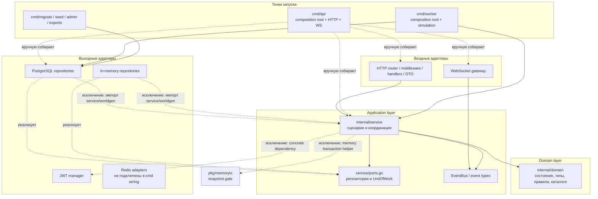
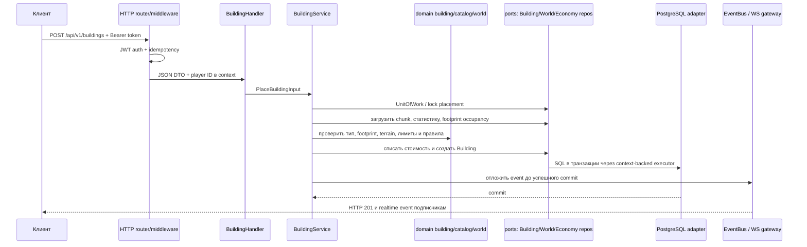

# Карта Go backend Real City

Подробный ориентир по слоям и модулям каталога `backend/`. Для общей картины frontend, сервисов и клиентского realtime см. [обзор всей системы](overview.md).

## Короткий ответ: это гексагональная архитектура?

**В основном да: backend использует подход ports and adapters, но это прагматичная, нестрогая реализация.** Главная зависимостная цепочка выглядит как `HTTP/worker → service → domain`, а `service/ports.go` задаёт интерфейсы хранилищ и Unit of Work; PostgreSQL и in-memory адаптеры реализуют эти интерфейсы. `cmd/api` и `cmd/worker` вручную собирают зависимости как composition root.

Есть подтверждённые протечки через границы:

1. `internal/service/auth.go` импортирует конкретный `internal/adapter/jwt.Manager`. Сервис аутентификации зависит от адаптера токенов напрямую, вместо интерфейса-порта.
2. `internal/adapter/postgres/world_repo.go` и `internal/adapter/memory/world_repo.go` импортируют `internal/service/worldgen`. Инфраструктурные адаптеры зависят от пакета, размещённого внутри application/service слоя.
3. Сервисы напрямую вызывают пакет `internal/observability` для метрик. Это удобная cross-cutting связь, но она тоже не выражена отдельным портом.
4. `internal/service/transaction.go` зависит от `pkg/memorytx` для реализации memory snapshot transactions; детали in-memory режима частично присутствуют в application layer.

При этом production-код пакетов `internal/domain/*` не импортирует `internal/service` или `internal/adapter`; отдельные domain-пакеты используют общий `pkg/apperror`. Поэтому точное описание: **слоистая архитектура с явными портами и адаптерами, близкая к гексагональной, с несколькими зависимостными исключениями**. Основание: `internal/service/ports.go`, composition roots `cmd/api/app.go` и `cmd/worker/main.go`, импорты в названных файлах. Это вывод по текущему коду, не оценка намерения авторов.

## Область и достоверность

- Режим `$investigate-codebase`: `ORIENT` с трассировкой размещения постройки.
- Исследованный `HEAD`: `5e8025d426a3b330cd6f48d6ec06da61b2d3a22a`.
- До создания этого файла `git status --short` показывал 454 изменённых/новых пути. Выводы отражают текущую рабочую копию; состояние части файлов может отличаться от `HEAD`.
- Источники — Go-код, `go.mod`, конфигурация запуска и миграции. Тесты, компиляция, сервер и production-среда не запускались.
- `SOURCE` означает вывод непосредственно из реализации; `CONFIG` — из декларативной конфигурации; `INFERRED` — архитектурная интерпретация зависимостей.

## Схема слоёв и процессов

Пунктирные стрелки к `service/ports.go` показывают обычное направление реализации портов: адаптер знает интерфейс приложения, а сервису не нужно знать конкретную базу. Пунктирные стрелки с пометкой «исключение» показывают фактические обратные зависимости. Схема упрощает многочисленные связи между игровыми сервисами; она не означает, что каждый запрос проходит через все модули.

## Слои

### 1. Точки запуска и сборка приложения: `cmd/`

`cmd/api/main.go` загружает конфигурацию и логгер, создаёт `app` и запускает HTTP-сервер, realtime gateway и фоновые циклы. `cmd/api/app.go` — composition root: выбирает реализации репозиториев, создаёт сервисы, связывает их через конструкторы и `Set...` методы, собирает router и WebSocket gateway.

`cmd/worker/main.go` — альтернативная точка запуска симуляции как отдельного процесса. Она требует общей PostgreSQL с API, поднимает репозитории и игровые сервисы, затем запускает `simulation.Runner` и метрики worker. `SIMULATION_EMBEDDED=true` — значение по умолчанию, при котором runner запускается внутри API.

Остальные команды — `cmd/migrate` для SQL-миграций, `cmd/seed` для начального наполнения, `cmd/test-admin` для тестовой учётной записи и `cmd/balance-export` / `cmd/catalog-export` для выгрузки игровых данных. Детали каждой команды следует сверять в её `main.go`.

### 2. Входные и выходные адаптеры: `internal/adapter/`

| Пакет | Роль |
|---|---|
| `http/` | Входной REST API. `router.go` регистрирует маршруты и middleware; `handler/` разбирает запрос и вызывает сервисы; `dto/` преобразует HTTP-формы в/из типов приложения и domain; `middleware/` отвечает за JWT-аутентификацию, idempotency, rate limits, request ID, логи, recovery и метрики. `openapi.go` публикует runtime OpenAPI. |
| `ws/` | WebSocket-транспорт: проверка токена, подписки по чанкам/приватным и alliance каналам, sequence номера, очередь сообщений на соединение и fan-out событий из `EventBus`. Gateway здесь относится к транспортному слою, а не к игровым правилам. |
| `postgres/` | Реализации репозиториев для PostgreSQL, `UnitOfWork`, idempotency store, блокировок и метрик очередей. `db.go` владеет `database/sql` pool. В репозитории 53 SQL-миграции в `db/migrations/`. |
| `memory/` | In-memory альтернативы тем же основным портам; используются при локальном запуске без DSN и в изолированных сценариях. Это отдельная реализация хранилищ, а не кэш перед PostgreSQL. |
| `jwt/` | Выдача и проверка access/refresh токенов. Сейчас это конкретная реализация, напрямую внедрённая в `AuthService` и использованная auth middleware/WebSocket gateway. |
| `redis/` | Есть client, session store и idempotency store, но в текущей сборке `cmd/api`/`cmd/worker` они не подключаются: сессии и idempotency выбираются через PostgreSQL при наличии БД, иначе используется память. Наличие папки и переменных конфигурации само по себе не означает использование Redis в запросах. |

### 3. Application/use-case слой: `internal/service/`

Сервисы принимают входные типизированные структуры, координируют проверки и доменные решения, вызывают порты хранилищ, управляют транзакциями и создают события. Это главный слой, куда обычно попадает логика конкретного сценария приложения.

| Направление | Файлы и ответственность |
|---|---|
| Аккаунт и игрок | `auth.go`, `player.go`, `profile.go`, `presence.go`, `experience.go`, `admin.go`, `admin_accounts.go`: регистрация/вход, профиль, присутствие, XP и административные действия. |
| Мир и окружение | `world.go`, `forest.go`, `worldgen/`: чтение чанков, изменение лесных клеток и генерация карты. `worldgen` — детерминированная генерация тайлов; сейчас она физически расположена под `service`, но импортируется и хранилищами. |
| Строительство | `building.go`, `building_transaction.go`, `building_destruction.go`, `repair.go`: размещение, завершение/улучшение, перенос/удаление, разрушение и ремонт. |
| Экономика и производство | `economy.go`, `resource.go`, `oil.go`, `production.go`, `field.go`, `population.go`: инвентарь, траты/начисления, ресурсные узлы, производство, поля и население. |
| Бой и угрозы | `combat.go`, `combat_log.go`, `monster.go`, `cannon.go`, `threat.go`, `pvp.go`, `pvp_protection.go`: атаки, монстры, оборона, PvP и последствия разрушения. |
| Социальная игра | `alliance.go`, `chat.go`, `market.go`: союзы, роли/казна/бонусы, чат и торговые заявки. |
| Сквозная координация | `ports.go`, `transaction.go`, `events.go`, `eventbus.go`, `outbox_forwarder.go`: контракты репозиториев, Unit of Work, доменные события и межпроцессная доставка. `app.go` содержит вспомогательные сервисные операции, не entry point процесса. |

Конструкторы принимают нужные интерфейсы и другие сервисы. `cmd/api/app.go` дополняет граф `SetEventBus`, `SetEconomy`, `SetExperience` и подобными setter-вызовами; это явная ручная сборка зависимостей, а не автоматический DI-контейнер.

### 4. Domain: `internal/domain/`

Здесь находятся структуры состояния, типы идентификаторов и правила, не привязанные к HTTP или конкретной базе. Domain-пакеты импортируют друг друга по игровым понятиям, но не импортируют service/adapter.

| Пакет | Основные понятия |
|---|---|
| `action` | Игровое действие/команда с актором, целью, временем исполнения и idempotency key; хранится через action repository и используется очередью симуляции. |
| `alliance` | Союз, членство, приглашения, казна, бонусы и поддержка территории. |
| `building` | Постройка, состояние, footprint, стоимости, лимиты, правила размещения и ремонт. `ValidatePlacement` — доменная проверка размещения. |
| `catalog` | Статические/версионируемые характеристики построек, экономики, рецептов, монстров, оружия, защиты и XP. Есть embedded JSON и сгенерированные Go-файлы; каталог используется сервисами как игровая конфигурация. |
| `chat` | Сообщение, курсор чтения, нормализация текста и moderation flag. |
| `combat` | Результаты и вычисления боевых действий. |
| `economy` | Ресурсы, баланс, инвентарь, транзакции, рецепты производства, поля, топливо и нефть. |
| `event` | Тип записи outbox и её состояние доставки (pending/sent/failed/dead). Публичные realtime payload/event types находятся отдельно в `service/events.go`. |
| `market` | Рыночный ордер, статусы и чистые правила цены/количества сделки. |
| `monster` | Монстр, spawn point, spec, события и loot drop. Планирование поведения находится в `worker/simulation`. |
| `player` | Игрок, сессия, профиль, пароль, присутствие, прогресс, население и PvP-состояние. |
| `world` | Карта, чанк, тайл, координаты, wrap-нормализация и изменение леса. |
| `territory` | Каталог существует, но в нём нет Go-исходников. В текущем коде связанные данные частично находятся в `alliance.TerritoryAid`; отдельная самостоятельная domain-модель территории не обнаружена. |

### 5. Фоновые циклы: `internal/worker/`

`worker/simulation/runner.go` — основной цикл тиков. Он связывает обработку очереди действий и игровых переходов с сервисами. Соседние файлы реализуют поля, нефть, генерацию монстров и `monster_ai.go`; боевые/пушечные сценарии подключаются через сервисы.

`worker/outbox_dispatcher.go` периодически читает доступные outbox-записи, публикует их в API-процессный EventBus, повторяет ошибки с задержкой и переводит исчерпавшие попытки события в dead state. В standalone worker `service.NewOutboxForwarder` сохраняет события в общую БД; gateway остаётся в API-процессе. Для embedded режима события передаются локально.

В `internal/worker/production_worker.go` находится отдельный `ProductionWorker`, который сейчас только периодически пишет log-событие `economy.production.tick`; в production-коде вызов его конструктора не найден. Реальная обработка production jobs подключена к `simulation.Runner` и `ProductionService`; не следует принимать этот логгер за основной механизм производства.

### 6. Межслойная инфраструктура

- `internal/observability/` — метрики HTTP, WebSocket, БД, очередей и симуляции; handlers для API и standalone worker. Метрики выставляются локально, Prometheus/Grafana заданы внешним Compose overlay.
- `internal/contract/types.go` — общие Go-структуры координат/ошибок. Ссылок на пакет из production Go-кода не обнаружено; основной HTTP-контракт фактически определяется router, DTO и OpenAPI.
- `db/migrations/` — эволюция схемы; `db/query/` содержит SQL-запросы и заметки для частей persistence.
- `pkg/config/` читает переменные окружения; `pkg/logger/` создаёт `slog`-логгер; `pkg/apperror/` задаёт общие типы ошибок; `pkg/memorytx/` синхронизирует in-memory snapshot-транзакции.
- `go.mod` задаёт Go 1.24; основные прямые зависимости — `github.com/lib/pq` для PostgreSQL и `golang.org/x/crypto` для криптографии паролей. JWT подписывается внутренней реализацией в `adapter/jwt`; WebSocket handshake также реализован в проекте, а не через отдельную прямую библиотеку.

## Сквозной пример: HTTP-запрос размещения постройки

`BuildingHandler` отвечает за transport decoding и извлечение игрока, `BuildingService` — за сценарий. Сервис проверяет каталог/участок/лимиты/занятость и стоимость, затем использует `BuildingRepository`, `WorldRepository` и EconomyService. `DestructionTransaction` оборачивает размещение в Unit of Work; общий `transactional` helper публикует накопленные события после успешного завершения транзакции. PostgreSQL `UnitOfWork` помещает `sql.Tx` в context, а `execer()` репозитория выбирает транзакцию вместо общего pool. Для in-memory режима применяется snapshot rollback через `snapshotUnitOfWork`.

Это статическая трассировка по вызовам, а не наблюдение работающего запроса. Путь начинается в `adapter/http/router.go` → `handler/building.go` → `service/building_transaction.go` → `service/building.go`; транзакционная граница описана в `service/transaction.go` и `adapter/postgres/uow.go`.

## Границы транзакций и событий

`UnitOfWork` — порт приложения; PostgreSQL адаптер реализует его SQL-транзакцией. В memory-режиме `buildUnitOfWork()` возвращает `nil`; `DestructionTransaction` подставляет snapshot-based реализацию и набор репозиториев для отката. `transactional()` откладывает публикацию событий из scope до успеха `Do()`. Это полезно для чтения критических сценариев: сохранение состояния и realtime-событие — связанные операции, но точная атомарность каждого игрового действия определяется тем, обёрнут ли конкретный путь в эту транзакционную обёртку.

## Где начинать изменение

| Задача | Основные точки изменения |
|---|---|
| Новое HTTP-действие | `adapter/http/router.go` → `handler/` → сервисный метод → DTO/OpenAPI и контрактные проверки. |
| Новое игровое правило | Соответствующий `domain/` пакет, его сервис-сценарий и тесты обоих уровней; transport слой только передаёт нужные данные. |
| Новый тип persistent state | Domain type → сервисный port в `service/ports.go` → `postgres/` и `memory/` реализации → миграция → composition roots. |
| Новый периодический процесс | `worker/simulation/` или отдельный worker entry point; явно определить, какая БД/очередь хранит состояние между процессами. |
| Новое realtime событие | Сервисный event type/payload и место публикации → outbox decode/WS mapping → клиентский контракт. Уточнить, выполняется ли публикация только после commit. |
| Игровой баланс/каталог | Источник данных и генератор в `data/`/`tools/`, runtime-модель `domain/catalog/`, затем согласованность с shared/frontend catalog. |

## Подтверждённые исключения и вопросы

1. **JWT-порт отсутствует:** `AuthService` принимает `*jwtadapter.Manager`. При замене или тестировании механизма токенов нужно менять/учитывать service package.
2. **`worldgen` размещён в service:** его импортируют memory/Postgres-адаптеры и несколько игровых сервисов. Это пакетный цикл зависимостей по слоям в смысле архитектурной модели, хотя Go import cycle отсутствует; перенос/инверсия потребуют отдельного решения.
3. **Широкие repository ports:** `BuildingRepository` и `EconomyRepository` содержат много операций разных сценариев. Портовая граница есть, но она не всегда узкая и направленная на одного потребителя.
4. **Territory не оформлен отдельным доменным модулем:** одноимённая директория пуста; связанные функции могут быть внутри `alliance`, `building` или `world`.
5. **Redis не подключён в runtime wiring:** его папка и переменные конфигурации могут быть заделом/неактивным адаптером; действующий adapter выбора session/idempotency — PostgreSQL либо memory.

## Порядок чтения Go backend

1. `backend/cmd/api/app.go` — увидеть полный граф зависимостей приложения.
2. `backend/internal/service/ports.go` — определить порты, от которых зависят use cases.
3. `backend/internal/adapter/http/router.go` и `middleware/auth.go` — изучить входные границы запроса и серверную identity.
4. `backend/internal/adapter/http/handler/building.go` — посмотреть transport-to-application mapping.
5. `backend/internal/service/building_transaction.go` и `building.go` — проследить размещение и проверки.
6. `backend/internal/domain/building/placement.go` и `domain/catalog/` — понять чистые правила и конфигурацию типов построек.
7. `backend/internal/service/transaction.go` и `backend/internal/adapter/postgres/uow.go` — разобраться в SQL-транзакции и отложенных событиях.
8. `backend/internal/adapter/postgres/building_repo.go` вместе с `memory/building_repo.go` — сравнить две реализации порта.
9. `backend/internal/worker/simulation/runner.go` и `monster_ai.go` — перейти от HTTP-сценариев к фоновому миру.
10. `backend/internal/service/eventbus.go`, `worker/outbox_dispatcher.go`, `adapter/ws/gateway.go` — изучить realtime-доставку.
11. `backend/db/migrations/` и `backend/internal/adapter/postgres/` — связать domain-модели с физической схемой.

## Вопросы для самопроверки

- Какой интерфейс нужно реализовать, если `BuildingService` должен начать читать постройки из нового хранилища?
- Почему `AuthService → jwtadapter.Manager` отличается от обычной зависимости сервиса от `PlayerRepository`?
- При ошибке записи постройки внутри `DestructionTransaction` какие данные должны откатиться, и в какой момент realtime event становится виден?
