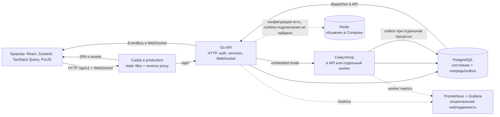

# Архитектурная карта Real City

Краткий обзор устройства проекта и ориентир для дальнейшего изучения backend. Карта описывает связи и потоки данных, а не перечисляет все каталоги.

## Как читать эту карту

- Режим: `ORIENT`, обзор архитектуры по исходникам и конфигурации.
- Снимок: `HEAD b8f00ee09e30998598f2454084adee25bf87259d`; в рабочей копии было 1114 изменённых или новых путей. Описание отражает текущее дерево файлов, а не гарантированно чистый коммит.
- Проверялись исходники, README, Compose и конфигурация развертывания. Тесты, серверы и production-среда не запускались.
- Утверждения о работающем поведении ниже основаны на коде (`SOURCE`); Compose и Docker-конфигурация показывают предполагаемую топологию, но не доказывают, что она сейчас развёрнута (`CONFIG`).

## Система в одном абзаце

Real City — браузерная многопользовательская стратегия с общей картой. Клиент на React загружает видимую область и состояние игровых объектов через HTTP, отправляет игровые действия на Go API и получает обновления по WebSocket. Backend проверяет действия, применяет игровые правила и владеет состоянием мира; PostgreSQL используется для постоянного хранения. Игровые тики выполняет встроенный в API симулятор либо отдельный Go worker. Основание: [README.md](../../../README.md), [backend/cmd/api/app.go](../../../backend/cmd/api/app.go), [backend/cmd/worker/main.go](../../../backend/cmd/worker/main.go).

## Основные компоненты

| Компонент | Ответственность и границы | Где смотреть |
|---|---|---|
| Игровой клиент | Vite + React + TypeScript; собирает игровые панели из `features/`, хранит интерактивное состояние в Zustand, серверные запросы и кэш — в TanStack Query. Изометрическую карту рисует PixiJS (`PixiStage`); Three.js используется в отдельных путях моделей, а не как основной рендер карты. | `frontend/src/main.tsx`, `frontend/src/app/App.tsx`, `frontend/src/features/`, `frontend/src/game/` |
| HTTP и realtime API | Go API задаёт HTTP-маршруты, переводит DTO в доменные запросы, применяет middleware и обслуживает WebSocket gateway. Клиент и сервер используют один домен/порт в конфигурации production через reverse proxy. | `backend/cmd/api/`, `backend/internal/adapter/http/`, `backend/internal/adapter/ws/` |
| Сценарии и правила игры | `service/` связывает игровые операции с хранилищами и другими сервисами. `domain/` содержит типы и правила мира, игрока, построек, экономики, боя, монстров, союзов и действий. Валидация действий выполняется на сервере. | `backend/internal/service/`, `backend/internal/domain/` |
| Хранение состояния | Репозитории отделяют сценарии от PostgreSQL и in-memory реализации. При заданном `POSTGRES_DSN` сборка API выбирает PostgreSQL; без DSN в development использует память. Production без DSN завершает запуск ошибкой. Миграции находятся в `backend/db/migrations/`. | `backend/cmd/api/app.go`, `backend/internal/adapter/postgres/`, `backend/internal/adapter/memory/`, `backend/db/` |
| Симуляция и события | `worker/simulation/` обрабатывает отложенные действия, производство, поля, ресурсы и поведение монстров. `EventBus` раздаёт события локальным подписчикам; gateway фильтрует их по подпискам клиентов. При отдельном worker события проходят через PostgreSQL outbox к API. | `backend/internal/worker/`, `backend/internal/service/eventbus.go`, `backend/internal/adapter/ws/gateway.go` |
| Общие данные и сборка контента | `shared/` содержит общие TypeScript-типы, координаты, события и каталоги. Игровые данные и проверки/генераторы лежат в `data/`, `tools/` и `docs/buildings/`; статические модели, изображения и аудио — в frontend assets. Это отдельный путь авторинга, не runtime-сервис игры. | `shared/`, `data/`, `tools/`, `docs/buildings/`, `frontend/public/` |

Диаграмма показывает связи, подтверждённые текущим кодом и конфигурацией, а не факт запущенных контейнеров. В development frontend запускается через Vite; production Compose задаёт отдельные backend и web images, а `deploy/Caddyfile` показывает правила reverse proxy и раздачи статики.

## Три сквозных потока

### 1. Первичная загрузка карты

Клиент выбирает видимые чанки через `useVisibleChunks` → `GET /api/v1/world/chunks` → `WorldHandler` → `WorldService` → `WorldRepository`. Репозиторий создаёт/читает чанки из выбранного хранилища. Клиент отдельно загружает постройки и другие игровые данные, кладёт ответы в клиентский кэш/игровое состояние и отображает карту через `PixiStage`. Запрос видимой области ограничен радиусом; клиент не обязан скачивать всю общую карту.

Опорные места: `frontend/src/features/world/useVisibleChunks.ts`, `frontend/src/shared/api/world.ts`, `backend/internal/adapter/http/router.go`, `backend/internal/adapter/http/handler/world.go`, `backend/internal/service/world.go`.

### 2. Размещение постройки

`BuildMenu` вызывает frontend API-клиент → `POST /api/v1/buildings` проходит аутентификацию и idempotency middleware → handler берёт ID игрока из контекста JWT и передаёт тип и координаты в `BuildingService` → сервис проверяет каталог, участок/чанки, занятость и лимит игрока, угрозы монстров, требования к ресурсу и стоимость → репозитории сохраняют списание и постройку → сервис публикует событие. API возвращает созданный объект инициатору; клиент сразу обновляет локальное состояние и инвалидирует связанные запросы. Подписанные WebSocket-клиенты получают realtime-событие.

Ключевые файлы: `frontend/src/features/buildings/BuildMenu.tsx`, `frontend/src/shared/api/buildings.ts`, `backend/internal/adapter/http/router.go`, `backend/internal/adapter/http/middleware/auth.go`, `backend/internal/adapter/http/handler/building.go`, `backend/internal/service/building.go`, `backend/internal/domain/building/placement.go`, `backend/internal/adapter/postgres/building_repo.go`.

### 3. Игровой тик и обновление других клиентов

По умолчанию `SIMULATION_EMBEDDED=true`: `cmd/api` создаёт `simulation.Runner` и запускает его рядом с HTTP-сервером и outbox dispatcher. В отдельном режиме `cmd/worker` требует общую PostgreSQL; его локальный EventBus направляет опубликованные события в outbox, API dispatcher выбирает записи и публикует их в EventBus процесса API, затем WebSocket gateway рассылает события соответствующим подпискам. Клиент следит за номерами последовательности и при reconnect/пропуске запрашивает сверку состояния.

Опорные места: `backend/pkg/config/config.go`, `backend/cmd/api/app.go`, `backend/cmd/worker/main.go`, `backend/internal/service/outbox_forwarder.go`, `backend/internal/worker/outbox_dispatcher.go`, `backend/internal/adapter/ws/gateway.go`, `frontend/src/shared/realtime/client.ts`, `frontend/src/features/world/realtime.ts`.

## Где искать логику по теме

| Если меняется… | Начните здесь |
|---|---|
| Координаты, чанки, генерация и состояние мира | `backend/internal/domain/world/`, `backend/internal/service/world.go`, `backend/internal/adapter/postgres/world_repo.go`; на клиенте `frontend/src/game/coordinates/` и `frontend/src/features/world/` |
| Правила и размещение построек | `backend/internal/domain/building/placement.go`, `backend/internal/service/building.go`, `backend/internal/adapter/http/handler/building.go`; данные каталога — `backend/internal/domain/catalog/` и `shared/catalog/` |
| Ресурсы, производство, поля и население | `backend/internal/domain/economy/`, сервисы `economy.go`, `resource.go`, `production.go`, `field.go`, `population.go`; клиентские панели в `frontend/src/features/` |
| Бой, монстры и угрозы | `backend/internal/domain/combat/`, `monster/`, `backend/internal/service/combat.go`, `monster.go`, `threat.go`, симуляция в `backend/internal/worker/simulation/` |
| HTTP-контракт, ошибки и доступ | `backend/internal/adapter/http/router.go`, `middleware/`, `dto/`, `backend/pkg/apperror/`; клиентские запросы — `frontend/src/shared/api/` |
| Экономические значения/каталог и баланс | `data/`, `backend/internal/domain/catalog/`, `shared/catalog/`; проверки согласованности перечислены в `scripts/check-contracts.sh` и `Makefile` |

Полезная ментальная модель: `handler` отвечает за транспорт и DTO; `service` — за сценарий и координацию; `domain` — за игровые типы/правила; `adapter` — за HTTP, JWT, WebSocket и конкретное хранилище. При изменениях проверяйте все четыре слоя и соответствующий frontend/контракт, если действие доступно игроку.

## Инфраструктура и сервисы

- **PostgreSQL 16** — постоянное хранилище в Compose; production и отдельный worker требуют общей БД. Миграции запускаются через `cmd/migrate` / Makefile.
- **Redis 7** — сервис задан в Compose, а `backend/pkg/config` содержит Redis-настройки и в репозитории есть адаптер. При этом в конструкторах API и worker подключение Redis не обнаружено: его роль в текущем runtime не подтверждена. Не предполагайте, что сессии или игровой кэш уже хранятся там.
- **Caddy** — production-конфигурация завершает TLS, отдаёт SPA/assets и проксирует `/api/*` к backend (`deploy/Caddyfile`).
- **Prometheus и Grafana** — отдельный Compose overlay для локальной наблюдаемости. API отдаёт `/metrics`, worker имеет собственный metrics endpoint. Это вспомогательные компоненты, не часть игрового запроса.
- В изученной production-конфигурации не обнаружены обязательные SaaS-интеграции вроде платёжного провайдера, почтового сервиса или внешнего объектного хранилища. Это ограниченный вывод по конфигурации и точкам запуска, а не гарантия отсутствия неиспользуемого кода.

## Контракты и достоверность

- API версии `/api/v1`; маршруты объявлены в `backend/internal/adapter/http/router.go`, runtime OpenAPI доступен по `/swagger/openapi.json`, снимок лежит в `backend/docs/swagger/openapi.json`.
- `shared/` — общий TypeScript-слой, но frontend сам вызывает endpoint через функции `frontend/src/shared/api/`; это не единая автоматически сгенерированная модель всего backend.
- `scripts/check-contracts.sh` связывает проверки API-контрактов с генерацией/сверкой ряда игровых данных. Не запускавшиеся проверки не считаются подтверждением корректности.
- Источник истины для игрового состояния — серверные сервисы и persistence, клиентский store — представление и интерактивное состояние. Frontend-предпросмотр не заменяет серверную валидацию.

## Расхождения и неизвестное

1. README называет симуляцию «будущей», но текущая сборка `cmd/api` уже создаёт и запускает её при включённом embedded-режиме. Для понимания текущей реализации ориентируйтесь на `app.go` и `worker/`, а не на эту формулировку README.
2. `docs/architecture/worker-realtime-delivery.md` описывает отсутствие producer/моста для событий отдельного worker. Текущие `cmd/worker/main.go` и `service/outbox_forwarder.go` уже задают публикацию в PostgreSQL outbox, а API создаёт dispatcher. Документ, вероятно, описывает более ранний срез; детали атомарности игрового изменения и записи события следует изучить отдельно.
3. Compose и исходники не подтверждают, какие сервисы реально запущены в текущей среде. Никакие production endpoint или credentials не использовались.
4. Redis объявлен, но его рабочее назначение в API/worker не установлено.

## Рекомендуемый маршрут чтения backend

1. `backend/cmd/api/app.go` — точка сборки зависимостей и режим запуска симуляции.
2. `backend/internal/adapter/http/router.go` — доступные API-действия и middleware.
3. `backend/internal/adapter/http/middleware/auth.go` — как JWT превращается в серверный ID игрока.
4. `backend/internal/adapter/http/handler/building.go` — граница HTTP и сценария.
5. `backend/internal/service/building.go` — последовательность правил и сайд-эффектов размещения.
6. `backend/internal/domain/building/placement.go` — доменные правила валидности размещения.
7. `backend/internal/service/ports.go` и `backend/internal/adapter/postgres/building_repo.go` — интерфейс сценария и конкретная запись в БД.
8. `backend/internal/service/eventbus.go` и `backend/internal/adapter/ws/gateway.go` — доставка realtime-событий.
9. `backend/internal/worker/simulation/runner.go` (найдите фактическое имя файла через `rg --files backend/internal/worker/simulation`) — цикл мира; затем `monster_ai.go` или нужную подсистему.
10. `backend/db/migrations/` — эволюция схемы и ограничения хранилища.

## Вопросы для самопроверки

- Если в development убрать `POSTGRES_DSN`, какие данные переживут перезапуск backend, а какие нет?
- Где окончательно решается, допустимо ли поставить здание на выбранную клетку: в UI, handler, service или domain?
- Что должно быть общим между API и отдельным worker, чтобы тики меняли тот же мир и realtime-события попадали подключённым клиентам?
