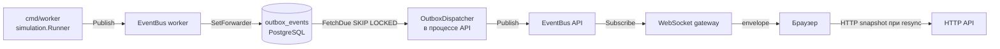
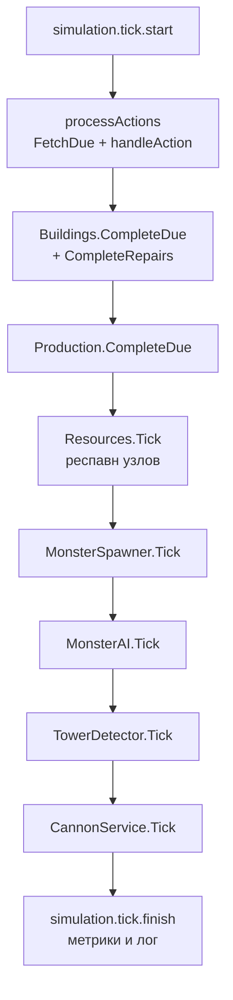
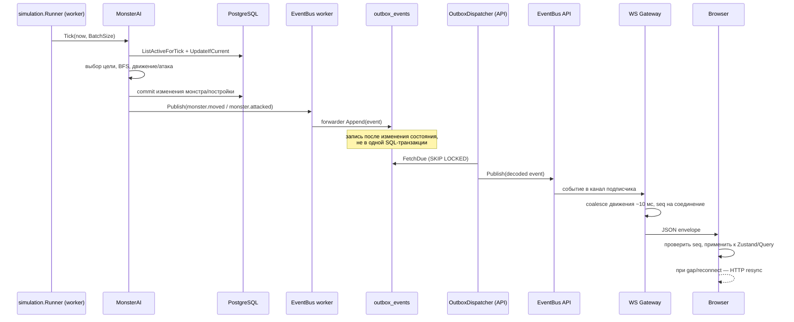

# Симуляция мира и WebSocket-доставка Real City

Разбор того, как сервер двигает общий мир и как изменения попадают в браузер. Дополняет [общую карту](overview.md) и [карту Go backend](backend-go.md); здесь основное внимание уделено циклу симуляции, событиям, outbox и WebSocket gateway.

## Короткий ответ

- Симуляция — это серверный цикл `simulation.Runner`, который по умолчанию раз в секунду последовательно обрабатывает очередь отложенных действий, завершение построек и ремонтов, производство, респавн ресурсов, спавн и AI монстров, сторожевые башни и пушки. Мир меняется только на сервере; клиент не является источником истины.
- Симуляция может работать внутри процесса API (`SIMULATION_EMBEDDED=true`, значение по умолчанию) или отдельным процессом `cmd/worker` с общей PostgreSQL. Отдельный worker не имеет WebSocket-клиентов: его события через `EventBus` пишутся в таблицу `outbox_events`, а API-процесс выбирает их и публикует в свой `EventBus`.
- WebSocket gateway живёт в API по адресу `GET /api/v1/realtime`. Он аутентифицирует access-токен, принимает команды `subscribe`/`unsubscribe`, держит индексы подписок по чанкам, приватному каналу игрока и каналу союза, а затем раздаёт события из `EventBus` только подходящим соединениям.
- Gateway сглаживает движение (`monster.moved`, `presence.moved`) в окне около 10 мс, ведёт собственный порядковый номер для каждого соединения и при переполнении очереди закрывает медленное соединение. Клиент при разрыве, пропуске `seq` или несовместимом кадре не пытается «доиграть» события, а перечитывает состояние мира по HTTP (resync).
- Главное ограничение: realtime-события в основном публикуются после изменения состояния, но не в одной транзакции с ним. В embedded-режиме основной поток событий не сохраняется для повторной доставки; источник истины при восстановлении — PostgreSQL/HTTP-снимок, а не журнал WebSocket-сообщений. Исключение — сторожевые тревоги в PostgreSQL-режиме, которые идут через outbox.

## Область и достоверность

- Режим `$investigate-codebase`: `TRACE` с элементами `ORIENT`, глубина `working`.
- Исследованный `HEAD`: `1f4e0c33f62c46e9e4408910c580dfb420cd77b1`.
- В рабочей копии на момент исследования `git status --short` показывал 72 изменённых/новых пути, в том числе `backend/cmd/api/app.go`, `backend/internal/adapter/ws/gateway_test.go`, `backend/internal/worker/outbox_dispatcher.go`. Выводы описывают текущую рабочую копию, а не гарантированно чистый `HEAD`.
- Изучались Go-исходники, конфигурация, миграции и frontend-клиент. Тесты, сервер, браузер и production-среда не запускались, поэтому все утверждения о поведении ниже имеют статус `SOURCE` (следует из кода) или `CONFIG`, а не `RUNTIME`.
- `SOURCE` — непосредственно из реализации; `CONFIG` — из декларативной конфигурации/Compose; `INFERRED` — архитектурная интерпретация; `CONTRADICTED` — найдено расхождение между документацией/ожиданием и кодом; `UNKNOWN` — не проверено.

## 1. Где живёт симуляция

### Встроенный режим (по умолчанию)

`backend/cmd/api/app.go#newApp` создаёт `simulation.Runner`, если `cfg.Simulation.Embedded == true`, и `backend/cmd/api/app.go#app.run` запускает его горутиной рядом с HTTP-сервером и outbox dispatcher. В этом режиме:

- сервисы API публикуют события в локальный `service.EventBus`;
- gateway подписан на тот же bus и сразу раздаёт события клиентам;
- outbox dispatcher в API всё равно запускается; события симуляции в embedded-режиме идут напрямую, но сторожевые тревоги при наличии PostgreSQL пишутся в outbox и доставляются через этот dispatcher.

Конфигурация по умолчанию: `SIMULATION_EMBEDDED=true`, `SIMULATION_TICK_INTERVAL=1s`, `SIMULATION_BATCH_SIZE=100`, `SIMULATION_LOCK_TTL=15s`, `OUTBOX_DISPATCH_INTERVAL=500ms` (`backend/pkg/config/config.go#SimulationConfig`).

### Отдельный worker

`backend/cmd/worker/main.go` — альтернативная точка запуска. Он требует общую PostgreSQL (`openPostgres` возвращает ошибку, если DSN нет) и собирает те же репозитории и сервисы, что API. Отличия:

- worker не создаёт WebSocket gateway;
- его `EventBus` получает forwarder `service.NewOutboxForwarder(outboxRepo)`, поэтому каждый `Publish` сначала синхронно пишет событие в `outbox_events`, а уже потом (фактически без локальных подписчиков) пытается раздать его в памяти;
- API-процесс при `SIMULATION_EMBEDDED=false` не создаёт `Runner`, но всегда создаёт и запускает `worker.OutboxDispatcher`, который читает outbox и публикует события в `EventBus` API, где их забирает gateway;
- API при `SIMULATION_EMBEDDED=false` без PostgreSQL завершает запуск ошибкой (`app.run`), чтобы не создавать иллюзию работающей симуляции на независимых in-memory хранилищах.

Итоговая топология доставки в standalone-режиме:



## 2. Тик симуляции

`backend/internal/worker/simulation/runner.go#Runner.tick` — центральная точка. `Run` создаёт `time.Ticker` с `TickInterval` и вызывает `tick(ctx, "scheduled")`; `Tick`/`CatchUp` вызывают тот же метод с другими режимами. Тик обрабатывает стадии строго последовательно, в одном goroutine:



Существенные детали:

- Если стадия возвращает ошибку, `tick` немедленно возвращает результат, и оставшиеся стадии в этом тике не выполняются. Паника перехватывается через `recover`, логируется со стеком и учитывается как `Failures`, после чего цикл продолжает работу со следующего тика.
- `TickResult` собирает счётчики по стадиям: действия, завершённые постройки, производство, респавн, спавн и обработка монстров, тревоги башен, выстрелы пушек, ошибки.
- `observability.Tick` и `observability.Stage` пишут метрики только для scheduled-тика; `catch_up` получает отдельный режим в общей метрике тика.
- `SIMULATION_WORKER_COUNT` присутствует в конфиге, но `Runner` его не использует: это один последовательный цикл, а не пул воркеров.

## 3. Очередь действий и транзакции

Долгие операции не выполняются в HTTP-запросе. Сервисы кладут запись в `game_actions`, а симуляция забирает её, когда наступает `due_at`.

Типы действий (`backend/internal/domain/action/action.go`): `complete_building`, `complete_production`, `respawn_resource`, `regrow_forest`, `detonate_weapon`. Дополнительно в очереди используются записи `combat_record` и `create_monster` как идемпотентные журнальные записи.

`Runner.processActions`:

1. `ActionRepository.FetchDue(ctx, now, BatchSize, LockTTL)` атомарно переводит подходящие записи в `running`, ставит `locked_until` и использует `FOR UPDATE SKIP LOCKED` в PostgreSQL-реализации (`backend/internal/adapter/postgres/action_repo.go#FetchDue`). Это позволяет нескольким процессам не брать одну и ту же запись.
2. Для каждой записи вызывается `handleAction`.
3. Успех → `MarkDone`; ошибка → `MarkFailed` с задержкой `1+attempts` секунд, но не более 30 секунд, и запись вернётся в `pending` с новым `due_at`.
4. Ошибка `MarkFailed`/`MarkDone` прерывает обработку пачки и возвращается из стадии.

`handleAction` для `detonate_weapon` оборачивает работу в `BuildingService.DestructionTransaction` вместе с репозиториями действий и монстров; комментарий в коде прямо фиксирует цель: урон, XP, подтверждение очереди и исходящие события должны попасть в один commit. Остальные действия выполняются через `UnitOfWork.Do`, а при отсутствии UoW (memory-режим) — напрямую.

`Runner.CatchUp` умеет вызвать `tick` с `WithoutActionQueue`, чтобы не трогать очередь действий, но в текущей проводке приложения нет вызова `Runner.CatchUp` и нет `EconomyService.SetCatchUp` вне тестов. Это важное расхождение с документацией, см. раздел 12.

## 4. Подсистемы мира

### Постройки, производство, ресурсы, поля

Эти стадии делегируются сервисам (`BuildingService.CompleteDue`, `CompleteRepairs`, `ProductionService.CompleteDue`, `ResourceService.Tick`). Сами правила (стоимость, лимиты, стадии роста, урожай) находятся в `service/` и `domain/`, а симуляция лишь выбираетdue-записи и применяет их. Поля и нефть не имеют отдельной стадии в `Runner`: `simulation/fields.go` и `simulation/oil.go` — небольшие helper-функции, а прогресс/сбор урожая идут через `FieldService`, `ProductionService` и действия.

### Спавн монстров

`backend/internal/worker/simulation/monster_spawner.go#MonsterSpawner.Tick`:

- гарантирует 100 сгенерированных точек спавна (`spawn_generated_NNN`), распределённых по wrapped-карте;
- для каждой точки проверяет `NextSpawnAt` и `MaxAlive` (по умолчанию 1);
- не спавнит на непроходимой клетке, в safe zone или ближе 3 клеток к постройке;
- если точка стала небезопасной, ищет новую по кольцам и сохраняет её;
- спавнит через `MonsterService.SpawnFromPoint`.

Кулдаун точки по умолчанию 90 секунд; после смерти монстра `MonsterAI` назначает точке новый `NextSpawnAt` через `service.RandomSpawnCooldown`.

### AI монстров

`backend/internal/worker/simulation/monster_ai.go#MonsterAI.Tick` — самая насыщенная часть:

- забирает живых монстров через `ListActiveForTick` с лимитом;
- на тик держит кэши чанков и построек, чтобы не читать одни и те же данные для каждого монстра;
- для каждого монстра в отдельной транзакции (`DestructionTransaction` или `UnitOfWork.Do`) выбирает цель, строит путь BFS, двигает, активирует ловушки, атакует постройку или другого монстра;
- выбор цели учитывает `AggroRadius`, предпочтения типа монстра к типу постройки, детерминированный «бросок» в сторону защитных построек (`defenseRoll` по ID монстра) и ближайшую клетку footprint;
- путь ограничен: радиус поиска 12–28 клеток и не более 2048 узлов BFS; скорость ограничивает число шагов за тик;
- ловушки на пути расходуют заряд, могут замедлить монстра и нанести урон; смерть от ловушки может дать XP владельцу;
- атака постройки проходит через `BuildingService.ProtectedDamage` и `PvPDamage`, затем `DamageIfCurrent` (оптимистичная блокировка по здоровью/владельцу); разрушение вызывает `HandleDestruction` и `RecordBuildingAttack`;
- при смерти создаётся лут и назначается респавн точки;
- изменения сохраняются через `UpdateIfCurrent`; конфликт (`errMonsterTickConflict`) означает, что состояние изменилось параллельно, и монстр пропускается без ошибки;
- события публикуются после успешной транзакции: движение, атака, урон, смерть, обновление/удаление постройки, срабатывание защиты.

### Сторожевые башни и пушки

`TowerDetector.Tick` сканирует мир не чаще раза в 5 секунд (`towerScanInterval`). Он смотрит на монстров в состоянии `aggro`/`attacking`, чья цель — постройка, и проверяет, попадает ли монстр в радиус активной башни (радиус зависит от уровня: 6–16). Тревога имеет кулдаун 1 минуту. В PostgreSQL-режиме тревоги сохраняются через `TowerAlertRepository` и затем доставляются как durable outbox-события; в memory-режиме — напрямую в `EventBus`. События: `tower.threat.detected` владельцу и `tower.threat.shared` союзникам.

`CannonService.Tick` вызывается последним: он выбирает готовые пушки и стреляет по монстрам, публикуя `cannon.shot`.

## 5. Рождение событий: EventBus и транзакционная публикация

`backend/internal/service/eventbus.go#EventBus` — локальный in-memory pub/sub:

- `Subscribe(ctx)` создаёт буферизованный канал (по умолчанию 64, в API используется `NewEventBus(128)`), удаляет подписчика при отмене контекста;
- `Publish(event)` сначала вызывает forwarder (если он есть), затем неблокирующе рассылает событие всем подписчикам;
- если канал подписчика переполнен, событие отбрасывается и вызывается drop handler.

`backend/internal/service/transaction.go` задаёт важную границу: `transactional(ctx, uow, fn)` накапливает события в контексте и публикует их только после успешного `Do`. `publishEvent` внутри такого scope не публикует сразу. Это используется в строительстве, экономике, рынке, чате, союзах, производстве, ремонте и других сценариях.

Но не все публикации идут через `transactional`:

- `MonsterAI` публикует события напрямую после завершения своей транзакции;
- `TowerDetector` публикует напрямую;
- часть сервисов вызывает `publishEvent` вне транзакционной обёртки.

Поэтому корректная формулировка: **для ряда операций событие появляется только после commit, но атомарность «изменение состояния + запись события» не является общей гарантией**. В standalone-режиме запись в outbox тоже происходит после изменения состояния, а не в той же SQL-транзакции.

## 6. Межпроцессная доставка: outbox

`service.NewOutboxForwarder` сериализует payload в JSON и вызывает `OutboxRepository.Append` с таймаутом 3 секунды. Таблица `outbox_events` описана в `backend/db/migrations/000009_simulation.sql`: id, type, aggregate/chunk/player/alliance, payload JSONB, status, attempts, next_attempt_at, locked_until, last_error, timestamps.

`worker.OutboxDispatcher`:

- `Run` тикает с `OutboxDispatchInterval` (500 мс) и раз в 10 секунд удаляет `sent`-записи старше часа пачками до 10 000;
- `Dispatch` забирает due-записи через `FetchDue` (`FOR UPDATE SKIP LOCKED`), восстанавливает типизированный payload по `EventType` и публикует в API-процессный `EventBus`;
- при ошибке, когда `attempts >= 5` (то есть после исчерпания пяти повторов), переводит запись в `dead`, иначе — в `pending` с задержкой `attempts+1` секунд;
- для `tower.threat.shared` использует отдельный guard `PublishSharedIfEligible`, чтобы не дублировать общие тревоги.

`decodePayload` в `backend/internal/worker/outbox_dispatcher.go` должен знать каждый тип события. Если тип новый, а ветка не добавлена, payload уйдёт как `map[string]any`, и gateway может отдать клиенту структуру, не совпадающую с ожидаемым DTO. Это точка, которую нужно обновлять при добавлении realtime-события.

## 7. WebSocket gateway

### Handshake и аутентификация

`Gateway.ServeHTTP` (`backend/internal/adapter/ws/gateway.go`):

1. `authenticate` берёт `Authorization: Bearer ...` или `?token=...` из query, проверяет access-токен через `jwt.Manager.VerifyAccess` и, если задан, `ValidateAccess(ctx, playerID, sessionID)` — проверку активной сессии.
2. `upgrade` реализует WebSocket handshake вручную: проверяет `Upgrade`/`Connection`, `Sec-WebSocket-Key`, делает `http.Hijacker`, считает `Sec-WebSocket-Accept` по SHA-1 + GUID и отвечает `101 Switching Protocols`. Внешняя WebSocket-библиотека не используется.
3. Создаётся `Connection` с очередью отправки 64, rate limiter 20 команд/сек, ping-интервалом 25 секунд и deadline записи 5 секунд.
4. Соединение регистрируется, публикуется `presence.changed` (online=true), клиенту отправляется `ack` с `connection_id` и `protocol_version`.
5. Запускается `WriteLoop`, затем текущая горутина читает команды в `readLoop`.
6. Если задан `accessValidator`, `watchAccess` раз в 2 секунды перепроверяет токен и сессию и закрывает соединение с причиной `session_revoked` при отзыве.

При закрытии соединения `disconnectLog` снимает его с индексов и публикует `presence.changed` (online=false).

### Команды и подписки

Клиент присылает JSON:

```json
{ "type": "subscribe", "chunk_ids": ["dev-world:0:0"], "private": true, "alliance_channel": "..." }
{ "type": "unsubscribe", "chunk_ids": ["dev-world:0:0"] }
```

`Connection.Apply` обновляет `SubscriptionSet`: набор чанков, флаг приватного канала и канал союза. Gateway после каждой команды пересчитывает индексы `chunkSubs`, `privateSubs`, `allianceSubs` и отправляет `ack`.

`targetConnections(event)` выбирает получателей так:

- если у события нет `ChunkID`, `PlayerID` и `Alliance` — событие уходит **всем** соединениям;
- иначе берётся объединение подписчиков чанка, приватного канала игрока и канала союза.

Это значит, что событие постройки, у которого заполнены и `ChunkID`, и `PlayerID`, получат и наблюдатели чанка, и владелец через приватный канал.

### Sequence, сглаживание и backpressure

- `forwardEvents` читает канал `EventBus` и накапливает «движущиеся» события (`monster.moved`, `presence.moved`) в течение ~10 мс, заменяя предыдущее событие того же монстра/игрока в том же чанке. Остальные события сначала сбрасывают накопленную пачку, затем отправляются сразу, чтобы не нарушать порядок.
- `EventEnvelope` формирует `EventID` на основе `CreatedAt` + типа + глобального `seq` gateway. При постановке в очередь соединения `EnqueueEvent` **перезаписывает `Seq`** на локальный монотонный номер этого соединения. Поэтому `event_id` и `seq` — разные вещи: `seq` нужен клиенту для обнаружения пропусков, `event_id` — для идентификации события.
- Очередь соединения — 64 сообщения. Если она переполнена, `EnqueueEvent` возвращает false, соединение закрывается с причиной `send_queue_full`, а gateway увеличивает счётчик drops. Клиент переподключится и сделает resync.
- Буфер `EventBus` — 128 на подписчика. При переполнении событие теряется, а drop handler `signalResync` рассылает всем соединениям `realtime.resync_required`, чтобы клиенты перечитали состояние.
- Gateway считает метрики: upgrades, auth failures, handshake failures, enqueued/delivered, event lag, slow consumers, fanout, drops.

### Инвалидация кеша

`Gateway.SetCacheInvalidator(worldService.InvalidateEvent)` вызывается до раздачи события. Если в API включён Redis-кеш чанков, события изменения тайлов, построек, ресурсов и монстров удаляют соответствующий ключ `real-city:cache:chunk:<chunkID>`, чтобы следующий HTTP-запрос не получил устаревший чанк.

## 8. Клиент

`frontend/src/shared/realtime/client.ts#RealtimeClient`:

- строит URL `${ws|wss}://${location.host}/api/v1/realtime?token=...`; в development Vite проксирует `/api` с `ws: true`, в production — Caddy;
- если access-токена нет, пытается обновить токены; при неудаче переходит в `offline`;
- при открытии сбрасывает `lastSeq`, очищает отправленные чанки, заново отправляет подписку и при переподключении запрашивает resync;
- `subscribeChunks` хранит желаемый набор чанков и отправляет только diff: `unsubscribe` для ушедших, `subscribe` для новых; всегда ставит `private: true`;
- на `ack` для `subscribe` запускает resync с причиной `subscription`, потому что HTTP-снимок мог быть получен до серверной подписки;
- отбрасывает события с `seq <= lastSeq`, при `seq > lastSeq + 1` запускает resync `gap`;
- при невалидном JSON, отсутствии `seq`, неверном `payload_version` или `realtime.resync_required` запускает resync;
- переподключение — экспоненциальная задержка `min(1000 * 2^attempt, 15000)` с джиттером 0.75–1.25, не более одного таймера одновременно.

`frontend/src/features/world/realtime.ts#useWorldRealtime` связывает клиент с UI:

- события складываются в очередь и применяются в `requestAnimationFrame` (если вкладка скрыта — сразу), чтобы не дёргать React-состояние на каждое сообщение;
- `applyRealtimeEvent` патчит Zustand (`updateWorldTile`, `addBuilding`, `deleteBuilding`, `upsertResourceNode`, `upsertMonster`) и кэш TanStack Query (`world/chunks`, `buildings`, `resources`, `monsters`, `monster-loot`, `chat`, `alliances`, `combat`, `market`, `inventory`);
- resync инвалидирует запросы: для `subscription` — только мир, для `reconnect`/`gap` — ещё инвентарь, население, производство, ремонты, чат, союзы и историю боя; вызовы debounce-ятся примерно на 1 секунду;
- аудио и уведомления (атака, тревога башни) также завязаны на события.

Важно: клиент не отправляет `alliance_channel` в `subscribe`, хотя gateway поддерживает такой канал. Серверные события союзов сейчас маршрутизируются через `PlayerID` (приватный канал каждого участника), поэтому на практике канал союза в текущей проводке не используется.

## 9. Сквозной пример: движение монстра в standalone-режиме



В embedded-режиме шаги `WB → OB → D` отсутствуют: `MonsterAI` публикует сразу в API-процессный `EventBus`, который читает gateway.

## 10. Контракты и инварианты

- **Сервер — источник истины.** Клиентские координаты, владение, стоимость и урон не принимаются на веру; все действия проходят серверную валидацию.
- **Тик — последовательный и ограниченный batch.** Стадии не параллелятся внутри `Runner`; `BatchSize` ограничивает выборку, `LockTTL` защищает от вечно «running» записей.
- **Долгие операции идут через `game_actions`.** HTTP-запрос не ждёт завершения постройки/производства; симуляция догоняет `due_at`.
- **Оптимистичная блокировка вместо глобального lock.** `UpdateIfCurrent`, `DamageIfCurrent`, `ConsumeTrapCharge`, `ClaimCannonShot` не дают двум процессам применить одно и то же состояние.
- **Событие после commit, но не всегда атомарно с ним.** `transactional` откладывает публикацию до успешного `Do`; прямые публикации `MonsterAI`/`TowerDetector` и запись в outbox происходят после изменения состояния.
- **WebSocket — best effort.** Нет подтверждения доставки клиентом, нет replay-журнала для embedded-режима. При пропуске или переподключении клиент обязан перечитать HTTP-снимок.
- **Порядок событий — на соединение.** `seq` монотонен в пределах одного WebSocket-соединения; после переподключения нумерация начинается заново.
- **Медленный клиент не тормозит мир.** Переполнение его очереди закрывает соединение, а не блокирует `EventBus` или симуляцию.

## 11. Evidence ledger

| Утверждение | Статус | Доказательство |
|---|---|---|
| `Runner` по умолчанию тикает раз в секунду и последовательно проходит стадии | `SOURCE` | `backend/internal/worker/simulation/runner.go#Run`, `#tick`; `backend/pkg/config/config.go#SimulationConfig` |
| В embedded-режиме `Runner` запускается в процессе API | `SOURCE` | `backend/cmd/api/app.go#newApp`, `#app.run` |
| Отдельный worker требует PostgreSQL и пишет события в outbox | `SOURCE` | `backend/cmd/worker/main.go#run`; `service.NewOutboxForwarder` |
| API всегда запускает `OutboxDispatcher` | `SOURCE` | `backend/cmd/api/app.go#app.run` |
| `OutboxDispatcher` использует `FOR UPDATE SKIP LOCKED`, retry и dead-letter | `SOURCE` | `backend/internal/worker/outbox_dispatcher.go#Dispatch`; `backend/internal/adapter/postgres/outbox_repo.go#FetchDue` |
| Действия забираются с блокировкой и повтором с backoff | `SOURCE` | `backend/internal/worker/simulation/runner.go#processActions`; `backend/internal/adapter/postgres/action_repo.go#FetchDue`, `#MarkFailed` |
| `detonate_weapon` обрабатывается в `DestructionTransaction` | `SOURCE` | `backend/internal/worker/simulation/runner.go#handleAction` |
| `CatchUp` не вызывается в production-проводке | `CONTRADICTED` | `rg SetCatchUp` находит только определение и тест; `rg CatchUp` — только определение метода `Runner.CatchUp` |
| `SIMULATION_WORKER_COUNT` не используется `Runner` | `SOURCE` | `rg WorkerCount` находит только поле и чтение конфига |
| `EventBus` неблокирующе рассылает события и вызывает drop handler при переполнении | `SOURCE` | `backend/internal/service/eventbus.go#Publish` |
| `transactional` публикует события после успешного `Do` | `SOURCE` | `backend/internal/service/transaction.go#transactional`, `#publishEvent` |
| Часть событий публикуется вне `transactional` | `SOURCE` | `backend/internal/worker/simulation/monster_ai.go#Tick` (публикация после транзакции), `tower_detector.go#Tick` |
| Gateway реализует handshake вручную и проверяет JWT/сессию | `SOURCE` | `backend/internal/adapter/ws/gateway.go#ServeHTTP`, `#authenticate`, `#upgrade`, `#watchAccess` |
| Gateway маршрутизирует события по чанку, приватному каналу и каналу союза | `SOURCE` | `backend/internal/adapter/ws/gateway.go#targetConnections`; `subscription.go` |
| `seq` переписывается на локальный номер соединения | `SOURCE` | `backend/internal/adapter/ws/connection.go#enqueue`; `gateway_test.go#TestConnectionSequencesOnlyDeliveredEvents` |
| Движение сглаживается в окне ~10 мс | `SOURCE` | `backend/internal/adapter/ws/gateway.go#forwardEvents`, `#coalescibleMovementKey` |
| Переполнение очереди соединения закрывает его | `SOURCE` | `backend/internal/adapter/ws/connection.go#enqueue`, `#Close` |
| Клиент делает resync при gap, reconnect и malformed frame | `SOURCE` | `frontend/src/shared/realtime/client.ts#handleMessage`, `#scheduleReconnect` |
| Клиент не отправляет `alliance_channel` | `SOURCE` | `frontend/src/shared/realtime/client.ts#sendSubscription`; `rg alliance_channel frontend/src` не находит отправку |
| Союзные события идут через `PlayerID`, а не `Alliance` | `SOURCE` | `backend/internal/service/alliance.go#notify` (`Event{Type: kind, PlayerID: id, ...}`) |
| Redis-кеш чанков инвалидируется по realtime-событиям, если кеш включён | `SOURCE` | `backend/internal/service/world.go#InvalidateEvent`; `app.go#newApp` |
| `docs/architecture/worker-realtime-delivery.md` описывает отсутствие outbox-моста | `CONTRADICTED` | Текущие `cmd/worker/main.go` и `service/outbox_forwarder.go` уже реализуют мост; документ, вероятно, устарел |
| Поведение реально работающего сервера/клиента проверено запуском | `UNKNOWN` | Тесты, сервер и браузер не запускались |

## 12. Расхождения, риски и неизвестное

1. **Catch-up описан, но не подключён.** `Runner.CatchUp`, `WithoutActionQueue`, `EconomyService.SetCatchUp` и `SIMULATION_CATCH_UP_LIMIT` существуют, но в `cmd/api` и `cmd/worker` нет вызова, который бы включал catch-up при входе игрока или загрузке состояния. Документы `docs/plans/plan.md` и `docs/operations/laptop-resource-optimization.md` ожидают catch-up на запросах; текущая проводка этого не подтверждает. Это может быть незавершённая интеграция или мёртвый код.
2. **`SIMULATION_WORKER_COUNT` не влияет на симуляцию.** Конфиг читается, но `Runner` — один последовательный цикл. Не стоит ожидать параллельной обработки тиков при увеличении значения.
3. **Устаревший документ о доставке.** `docs/architecture/worker-realtime-delivery.md` утверждает, что производителей outbox нет и API запускает dispatcher только при embedded-симуляции. Код уже реализует обратное: worker пишет outbox, API запускает dispatcher всегда. Документ стоит обновить или пометить историческим.
4. **Канал союза в WebSocket не задействован.** Gateway и `SubscriptionSet` поддерживают `alliance_channel`, но клиент его не отправляет, а серверные события союзов адресуются через `PlayerID`. Это не ошибка доставки, но неиспользуемая ветка, которую легко принять за рабочую подписку на союз.
5. **Атомарность «состояние + событие» не универсальна.** `transactional` покрывает многие сценарии, но `MonsterAI`, `TowerDetector` и outbox-forwarder публикуют после изменения состояния. При падении между commit и публикацией/записью outbox realtime-событие может потеряться; клиент увидит изменение только после HTTP-resync.
6. **Ошибки forwarder часто игнорируются.** `EventBus.Publish` возвращает ошибку при неудачной записи в outbox, но многие вызывающие (`publishEvent`, `MonsterAI`, часть сервисов) не проверяют возврат. Ошибка логируется внутри `Publish`, но не останавливает игровой сценарий; событие может быть потеряно.
7. **Нет replay-журнала для embedded-режима.** WebSocket-события не сохраняются для повторной доставки. Восстановление после разрыва — только через HTTP-снимок и resync-инвалидацию.
8. **Медленный клиент теряет соединение.** Это осознанный backpressure-выбор: очередь 64 сообщения, затем закрытие. Клиент должен переподключиться; при частых переподключениях возможны повторные resync-нагрузки на HTTP.
9. **Два процесса симуляции на одной БД.** `MonsterAI` использует оптимистичные проверки, но `MonsterSpawner` и `TowerDetector` не имеют распределённого claim. Документация прямо не рекомендует запускать две симуляции на одной БД; код это не запрещает.
10. **Не проверено в runtime.** Не запускались `go test`, сборка, сервер и браузер. Утверждения о фактической доставке, задержках и поведении при переполнении основаны на коде и тестах-исходниках, а не на наблюдении.

## 13. Рекомендуемый маршрут чтения

1. `backend/cmd/api/app.go` — как собираются сервисы, `EventBus`, `Runner`, outbox dispatcher и gateway.
2. `backend/cmd/worker/main.go` — отличия standalone-режима и подключение outbox-forwarder.
3. `backend/internal/worker/simulation/runner.go` — порядок стадий, действия, ошибки и транзакционные границы.
4. `backend/internal/worker/simulation/monster_ai.go` — самый сложный пример изменения мира и публикации событий.
5. `backend/internal/worker/simulation/monster_spawner.go` и `tower_detector.go` — периодические подсистемы и их ограничения.
6. `backend/internal/service/eventbus.go` и `transaction.go` — рождение и отложенная публикация событий.
7. `backend/internal/service/outbox_forwarder.go`, `backend/internal/worker/outbox_dispatcher.go`, `backend/internal/adapter/postgres/outbox_repo.go` — межпроцессная доставка.
8. `backend/internal/adapter/ws/gateway.go` — handshake, auth, подписки, маршрутизация, coalescing и backpressure.
9. `backend/internal/adapter/ws/connection.go` и `protocol.go` — кадры, `seq`, формат envelope.
10. `frontend/src/shared/realtime/client.ts` — переподключение, gap detection и resync.
11. `frontend/src/features/world/realtime.ts` — применение событий к Zustand и TanStack Query.
12. `backend/db/migrations/000009_simulation.sql` — физическая схема `game_actions` и `outbox_events`.

## 14. Вопросы для самопроверки

- Если `SIMULATION_EMBEDDED=false`, а PostgreSQL недоступна, что произойдёт с API и что — с worker?
- Где именно событие `monster.attacked` становится видимым WebSocket-клиенту и какие процессы участвуют в этом пути в embedded- и standalone-режимах?
- Почему `seq` в envelope не равен глобальному счётчику gateway и как клиент обнаруживает пропуск?
- Что произойдёт с медленным клиентом, у которого переполнилась очередь отправки, и как он восстановит состояние?
- Какие события публикуются после commit, а какие — вне транзакционной обёртки, и какие последствия это имеет при сбое процесса?
