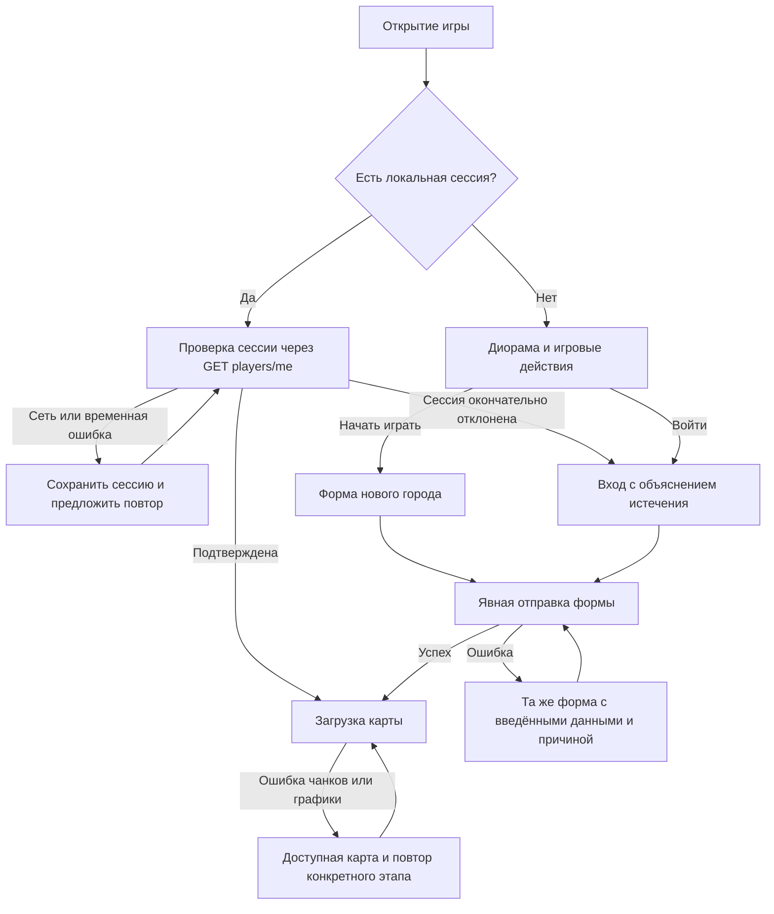

# Стартовая страница: маршруты и контракты

Пункты 1Б.1–1Б.6, 31.10.2026: маршруты, макеты, формы, загрузка и помощь реализованы. 01.11.2026 исходная рисованная диорама заменена статичным Blender-рендером игровых моделей; рядом с названием подключена Blender-эмблема, добавлены ICO/PNG favicon-варианты и manifest. Полная приёмка 1Б.7 с клавиатурой на физическом мобильном устройстве остаётся открытой. Авторизованный игрок попадает на карту, а гостевой вход не становится обязательной промежуточной страницей каждого запуска. Шрифт и серверный способ авторизации сохранены.

## Маршруты

| Состояние | Действие интерфейса | Условие перехода |
|---|---|---|
| Посетитель | Авторская диорама, «Начать играть», «Войти», три игровых принципа | Нажатие открывает/фокусирует нужную форму; запрос регистрации ещё не отправляется |
| Новый игрок | Форма email, имени города и пароля, подписи и правила полей | Только явная кнопка «Создать город» вызывает register |
| Возвращающийся игрок без сессии | Форма входа, autocomplete email/current-password | Успех login возвращает на карту; ошибка сохраняет поля |
| Действующая сессия | Краткая проверка сессии без промоэкрана | Подтверждённый players/me, затем однократное подключение игрового дерева |
| Истёк access token | Один владелец обновления сессии | Успешный refresh → повтор players/me; окончательный отказ → вход |
| Временная ошибка API/сети | Понятная причина и «Повторить» | Не удалять сессию только из-за сетевой ошибки/5xx |
| Ошибка загрузки карты/графики | Фактический этап без вымышленного процента | Повторяет соответствующий этап, сохраняя уже загруженную карту |
| Повторное открытие/обновление страницы | Повторная проверка сессии | Не вызывает register и не создаёт второй аккаунт |

«Первый вход» означает короткую закрываемую помощь с выбором места/центра и показом реальной цены из каталога. Она не ставит здание сама, не выдаёт локальные награды и не блокирует управление длинным обучением. При отсутствии WebGL требуется объяснение и действие восстановления; нельзя показывать успешную готовность пустого canvas.

## Действующие контракты

- [auth/api.ts](../../frontend/src/features/auth/api.ts): POST `/api/v1/auth/register`, `/auth/login`, `/auth/refresh`, `/auth/logout`; регистрация/вход возвращают игрока и токены и сохраняют их текущим способом.
- [client.ts](../../frontend/src/shared/api/client.ts): GET `/api/v1/players/me` и обновление access token; регистрация/вход не повторяются автоматически по механизму refresh.
- [AuthGate](../../frontend/src/features/auth/AuthGate.tsx) и [AuthScreen](../../frontend/src/features/auth/AuthScreen.tsx): существующие входные состояния. Новая страница должна использовать те же контракты.
- [App](../../frontend/src/app/App.tsx): игровые синхронизации и WebSocket монтируются после подтверждения авторизации. Повтор формы/загрузки не должен добавлять параллельные соединения.
- [router.go](../../backend/internal/adapter/http/router.go): публичные `/health`, `/healthz`, `/ready`. Статус должен отражать реальный ответ, а не выдуманный онлайн. HTML dev-сервера с HTTP 200 не является подтверждением готовности API; перед подключением индикатора требуется корректный proxy-маршрут и проверка JSON.

## Сохранение намерения и защита от повторов

Выбор «вход»/«новый город» хранится в состоянии формы; не переключать его из-за ошибки сети. Действие «Начать играть» выбирает регистрацию, но не отправляет её. Отправка имеет явный pending и защиту от повторного нажатия. После успешного ответа сохраняются токены/игрок и открывается карта; успех не выполняет повторную регистрацию после перезагрузки.

При повторной авторизации сохраняется намерение осмотреть выбранную публичную цель, а не готовый запрос атаки/строительства. После входа серверные запасы, права и доступность проверяются заново; опасное действие не воспроизводится автоматически. При смене аккаунта очищаются приватные кеши и намерения управления прежним городом. Токены, пароль, email, инвентарь и координаты построек не помещаются в URL или диагностические события.

Ошибки полей связываются с полями через aria-describedby/aria-invalid; общая ошибка имеет следующий шаг. Пароль можно показать явной кнопкой. Повтор и смена формы сохраняют безопасные введённые данные; после подтверждённого выхода пароль не восстанавливается из постоянного хранилища.

## Реализация и проверка 1Б.2–1Б.6

`AuthScreen` показывает адаптивный рендер сцены, эмблему рядом с текстовым названием, два явных действия, переключатель формы и фактический статус `/ready`. Vite проксирует `/ready`; Caddy уже имеет этот маршрут. Ошибка статуса не блокирует форму. Макеты: [снимки и описание](../assets/ui/concepts/start/README.md). Источник сцены — `tools/assets/ui/start-city/start-city.blend`, генератор `tools/assets/ui/build_start_blender_assets.py`; Blender импортирует игровые модели ратуши и жилья и собирает изометрический участок с дорогой, садом и деревьями. Desktop/mobile WebP занимают 45.6 KiB суммарно. Если основной файл сцены недоступен, экран пробует меньший рендер, затем показывает лёгкий CSS-fallback. Нового WebGL-контекста до входа нет.

Форма сохраняет значения при отказе, связывает ошибки полей с вводом, поддерживает autocomplete и показ пароля, предотвращает повторную отправку до окончания запроса. Для регистрации пароль ≥10 символов; вход не навязывает новое ограничение существующему паролю. Пароль не записывается в хранилище.

`session.ts` объединяет параллельные проверки, включая StrictMode. Единственный владелец refresh — API-клиент: запросы делят одно обновление токена. Сеть/5xx не стирают токены; окончательный отказ возвращает на вход с объяснением. Cleanup эффекта игнорирует результат уже размонтированной проверки.

`MapEntryStatus` читает тот же запрос чанков, что и `IsoMap`: загрузка участка, подготовка графики, медленный ответ после 8 секунд, ошибка/повтор. Существующий `world-status` продолжает показывать reconnect и отсутствие данных района. `PixiStage` сообщает о готовности только после создания canvas; ошибка инициализации предлагает проверить WebGL и повторить запуск. Защита pending не допускает параллельные старты. Повтор чанков или графики не перемонтирует игровое дерево и не открывает дополнительный WS. `MapAssetStatus` отдельно предлагает повтор текстур и сообщает об упрощённой графике.

`FirstCityHelp` появляется только после загрузки собственного списка зданий и при отсутствии центра. Цена и размер берутся из каталога, в текущем балансе центр бесплатный. Помощь объясняет выбор клетки и ограничения ландшафта, открывает обычный предпросмотр и строительство. Закрытие сохраняется отдельно для игрока; ни наград, ни автоматической постройки нет. На карте остаются клавиатурный выбор координат и стандартная проверка размещения.

Проверено: production build, 384 unit-теста, в том числе 8 новых проверок форм, StrictMode, сетевого повтора, истечения, refresh, помощи и стадий карты. Chromium: desktop 1440×900, mobile 390×844, 320×700, уменьшенная область 390×480. При 390×844 обе формы доступны без обязательного скролла; настоящий мобильный ввод и полный игровой цикл с живым сервером ещё не приняты.

Дополнительно пройдены существующие браузерные сценарии auth/контраста, карты, панелей, масштаба текста, эффектов и fallback. При первом прогоне помощь перекрыла кнопку строительства desktop; расположение исправлено, повтор desktop/mobile прошёл. На мобильном помощь имеет ограниченную высоту и собственную прокрутку, чтобы сохранять доступ к игровым панелям.

## Оставшаяся приёмка 1Б.7

Обновление 31.10.2026: [проверка живого backend и исправления](interface-next-five-review.md). Регистрация, первый центр, WebSocket, reload и восстановление после временной ошибки проверены. Auth учитывает visualViewport и сохраняет активное поле в видимой области. Непроверенной остаётся настоящая клавиатура Android/iOS на физическом устройстве; пункт 1Б.7 частичный.

Обновление 01.11.2026: новый рендер и эмблема включены в AuthScreen; сценарии перехода и формы не менялись. Browser-review прошёл на 320×700, 390×844 и 1440×900: сцена, эмблема и favicon загружаются, ошибка API сохраняет поля, уменьшение mobile viewport сохраняет фокус и видимость активного поля. Физической клавиатуры для полноценного Android/iOS smoke в среде нет, поэтому 1Б.7 остаётся частичным до проверки на устройстве.

Проверки: посетитель → регистрация без скрытого POST, вход, действующая сессия → карта напрямую, успешный/отклонённый refresh, 5xx/обрыв сети без потери сессии, сохранение формы после ошибки, двойной тап, обновление страницы, WebGL/fallback, медленная загрузка, виртуальная клавиатура и возврат фокуса. Матрица размеров наследует 320/390/768/1024/1440 px; новая диорама остаётся лёгкой статичной сценой без второго WebGL-контекста до игры.
